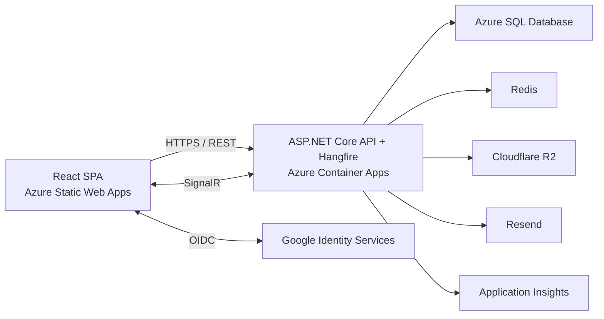

# UUcars Marketplace

UUcars is an independently designed and developed full-stack portfolio project
that models a C2C used-car marketplace. It combines an ASP.NET Core API, a React
frontend and an Azure production deployment.

## Implemented capabilities

- Email/password and Google sign-in, email verification, password reset, JWT
  access tokens and refresh-token rotation
- User and Admin authorisation, ownership checks, rate limiting, security
  headers and administrative audit logs
- Vehicle drafts, image upload and ordering, moderation, public browsing,
  pagination, filtering and search
- Favourites, orders, order completion, reviews and seller rating summaries
- Persistent notifications with real-time SignalR delivery
- Admin analytics with cached metrics, trends and brand distribution
- Redis cache-aside, Hangfire background jobs, an Admin-protected Hangfire
  Dashboard, structured logging and Application Insights production telemetry
- Backend unit and integration tests, frontend component tests and real
  Playwright end-to-end journeys
- Docker-based local infrastructure, a non-root API container, Azure Container
  Apps Secret references and GitHub Actions CI/CD to Azure

## Architecture

The backend uses Controller–Service–Repository separation. The frontend keeps
routing, server state, authentication state, forms and API access in distinct
layers. See [System architecture](docs/technical/architecture.md) for the detailed
component, data and route reference.

## Technology overview

| Area | Main technologies |
|---|---|
| Backend | ASP.NET Core, Entity Framework Core, SQL Server |
| Frontend | React, TypeScript, Vite, React Router, Tailwind CSS |
| State and forms | TanStack Query, Zustand, React Hook Form, Zod |
| Infrastructure | Redis, Hangfire, SignalR, Cloudflare R2, Resend |
| Observability | Serilog, Azure Application Insights |
| Testing | xUnit, Testcontainers, Vitest, React Testing Library, Playwright |
| Delivery | Docker, GitHub Actions, GHCR, Azure Container Apps, Azure Static Web Apps, Azure SQL Database |

Exact dependency versions are defined by the project and package manifests.

## Get started

The local system requires the .NET SDK, Node.js and a Docker-compatible runtime.
The API, SQL Server and Redis run through Docker Compose using an ignored root
`.env` file. The frontend runs locally with an ignored `.env.local` file.

Follow [Local development](docs/technical/local-development.md) for complete
configuration and startup instructions.

## Documentation

| Document | Purpose |
|---|---|
| [System architecture](docs/technical/architecture.md) | Current application structure, responsibilities, data model and principal routes |
| [Database schema](docs/technical/database-schema.md) | Current fields, indexes, relationships, delete behaviour and migration history |
| [Local development](docs/technical/local-development.md) | Prerequisites, secrets, infrastructure and startup |
| [Testing and quality checks](docs/technical/testing.md) | Local backend, frontend and end-to-end validation |
| [Production delivery](docs/technical/production-delivery.md) | Implemented hosting, CI/CD and production configuration boundaries |
| [Development workflow](docs/technical/development-workflow.md) | Branch, integration and release responsibilities |
| [V1 design](docs/design/v1.md) | Original MVP scope and implementation sequence |
| [V2 design](docs/design/v2.md) | Full-stack frontend and first production-deployment scope |
| [V3 design](docs/design/v3.md) | Performance, security, testing, real-time and delivery scope |
