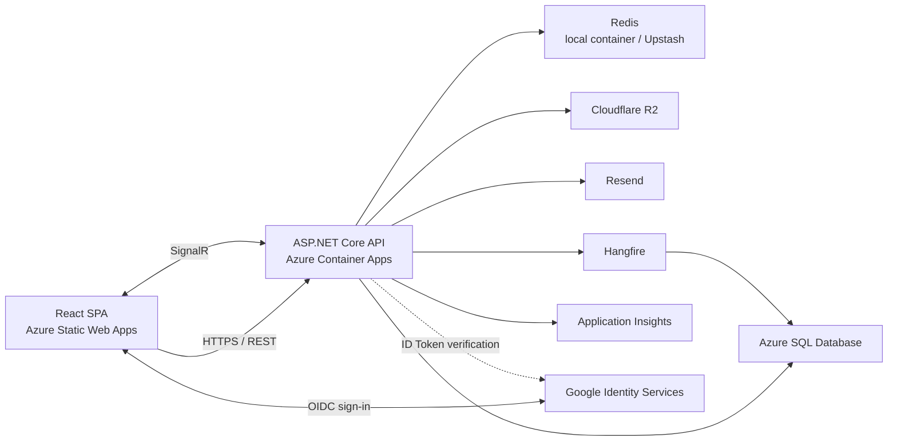

# System architecture

UUcars is a React single-page application backed by an ASP.NET Core Web API. The
production system uses managed Azure hosting together with external identity,
object storage and email services.



## Backend responsibilities

The API follows a Controller–Service–Repository structure:

```text
HTTP request
→ Controller
→ Service business rules
→ Repository or external-service adapter
→ EF Core, Redis, R2, Resend or SignalR
→ ApiResponse<T>
```

Controllers handle transport concerns, Services enforce business rules, and
Repositories contain database query and persistence behaviour. External-service
adapters isolate integrations such as email, object storage and identity-token
verification.

## Frontend responsibilities

The frontend keeps route definitions centralised and separates route-level pages,
shared components, API modules, server state and authentication state. The Axios
client attaches access tokens and handles shared transport failures; feature API
modules unwrap the established response envelope.

## Technology overview

| Area | Technologies |
|---|---|
| Backend | ASP.NET Core 10, C#, Entity Framework Core 10, SQL Server |
| Authentication | JWT Bearer authentication, refresh-token rotation, Google OpenID Connect, ASP.NET Core PasswordHasher |
| Frontend | React 19, TypeScript 6, Vite 8, React Router 7 |
| UI | Tailwind CSS 4, shadcn/ui, Radix UI, Lucide React, Embla Carousel, Recharts |
| State and data | Zustand, TanStack Query 5, Axios |
| Forms | React Hook Form, Zod |
| Infrastructure | Redis, Hangfire, Cloudflare R2, Resend, SignalR |
| Observability | Serilog, Azure Application Insights |
| Testing | xUnit, WebApplicationFactory, Testcontainers, Vitest, React Testing Library, Playwright |
| Delivery | Docker, Docker Compose, GitHub Actions, GHCR, Azure Container Apps, Azure Static Web Apps, Azure SQL Database |

## Repository layout

```text
UUcars/
├── UUcars.API/                 ASP.NET Core API
│   ├── Controllers/
│   ├── Services/
│   ├── Repositories/
│   ├── Entities/
│   ├── DTOs/
│   ├── Configurations/
│   ├── Migrations/
│   ├── Middleware/
│   ├── Extensions/
│   └── Hubs/
├── UUcars.Tests/               Backend unit and integration tests
├── uucars-web/                 React application and end-to-end tests
├── docs/design/                Version design proposals
├── docs/technical/             Current technical references
├── .github/workflows/          CI/CD workflows
├── Dockerfile
├── docker-compose.yml
└── UUcars.sln
```

## Data model

The current EF Core model contains Users, Cars, CarImages, Favorites, Orders,
Reviews, RefreshTokens, ExternalLogins, AuditLogs and Notifications. EF Core
Migrations and `AppDbContextModelSnapshot` are the authoritative definition.

See [Database schema](database-schema.md) for fields, indexes, relationships,
delete behaviour and the migration timeline.

## Principal API routes

The API uses a common `ApiResponse<T>` envelope.

| Area | Routes |
|---|---|
| Authentication | `POST /auth/register`, `POST /auth/login`, `POST /auth/google`, `POST /auth/refresh`, `POST /auth/logout` |
| Current user | `GET /users/me`, `PUT /users/me` |
| Vehicles | `GET /cars`, `GET /cars/{id}`, `POST /cars`, `PUT /cars/{id}`, `DELETE /cars/{id}`, `POST /cars/{id}/submit`, `GET /cars/my-listings` |
| Vehicle images | `POST /cars/{id}/images`, `POST /cars/{id}/images/batch`, `PUT /cars/{id}/images/reorder`, `DELETE /cars/{id}/images/{imageId}` |
| Favourites | `GET /favorites`, `GET /favorites/{carId}`, `POST /favorites/{carId}`, `DELETE /favorites/{carId}` |
| Orders | `POST /orders`, `POST /orders/{id}/cancel`, `POST /orders/{id}/complete`, `GET /orders/my-purchases`, `GET /orders/my-sales` |
| Reviews | `POST /reviews`, `GET /reviews/seller/{sellerId}` |
| Notifications | `GET /notifications`, `PUT /notifications/{id}/read`, `PUT /notifications/read-all` |
| Admin | `GET /admin/stats`, `GET /admin/cars/pending`, moderation and audit-log routes |
| SignalR | `/hubs/notification` |

Interactive Scalar documentation is available at
`http://localhost:5065/scalar/v1` when the API runs in Development.
