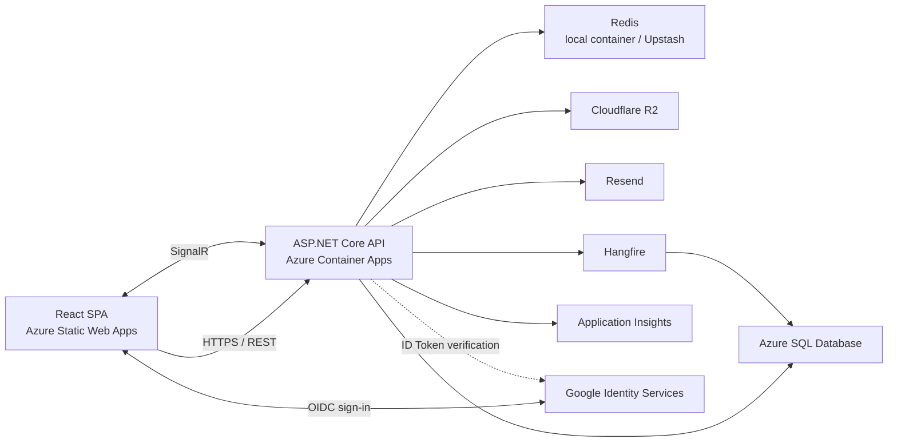

# System architecture

UUcars is a React single-page application backed by an ASP.NET Core Web API. The
production system uses managed Azure hosting together with external identity,
object storage and email services.



## Backend responsibilities

The API follows a Controller–Service–Repository structure:

```text
HTTP request
→ Controller
→ Service business rules
→ Repository or external-service adapter
→ EF Core, Redis, R2, Resend or SignalR
→ ApiResponse<T>
```

Controllers handle transport concerns, Services enforce business rules, and
Repositories contain the main database query and persistence behaviour.
`AdminCarService` also queries audit logs directly through `AppDbContext`, and
`OrderService` uses the context for transaction boundaries. External-service
adapters isolate integrations such as email, object storage and identity-token
verification.

## Frontend responsibilities

The frontend keeps route definitions centralised and separates route-level pages,
shared components, API modules, server state and authentication state. The Axios
client attaches access tokens and handles shared transport failures; feature API
modules unwrap the established response envelope.

Access tokens stay in Zustand memory; only the user profile is persisted in
localStorage. Refresh tokens travel in HttpOnly cookies. The notification bell
combines the unread-notification API with SignalR `ReceiveNotification` events.

Create/edit, Admin and Google sign-in components use React lazy imports with
Suspense and route Error Boundaries. The hero image is eager/high priority;
selected off-screen cards and thumbnails use lazy loading. Bundle analysis is
opt-in, not part of every production build.

## Technology overview

| Area | Technologies |
|---|---|
| Backend | ASP.NET Core 10, C#, Entity Framework Core 10, SQL Server |
| Authentication | JWT Bearer authentication, refresh-token rotation, Google OpenID Connect, ASP.NET Core PasswordHasher |
| Frontend | React 19, TypeScript 6, Vite 8, React Router 7 |
| UI | Tailwind CSS 4, shadcn/ui, Radix UI, Lucide React, Embla Carousel, Recharts, dnd-kit |
| State and data | Zustand, TanStack Query 5, Axios |
| Forms | React Hook Form, Zod |
| Infrastructure | Redis, Hangfire, Cloudflare R2, Resend, SignalR |
| Observability | Serilog, Azure Application Insights |
| Testing | xUnit, WebApplicationFactory, Testcontainers, Vitest, React Testing Library, Playwright |
| Delivery | Docker, Docker Compose, GitHub Actions, GHCR, Azure Container Apps, Azure Static Web Apps, Azure SQL Database |

## Repository layout

```text
UUcars/
├── UUcars.API/                 ASP.NET Core API
│   ├── Controllers/
│   ├── Services/
│   ├── Repositories/
│   ├── Entities/
│   ├── DTOs/
│   ├── Configurations/
│   ├── Migrations/
│   ├── Middleware/
│   ├── Extensions/
│   └── Hubs/
├── UUcars.Tests/               Backend unit and integration tests
├── uucars-web/                 React application and end-to-end tests
├── docs/design/                Version design proposals
├── docs/technical/             Current technical references
├── .github/workflows/          CI/CD workflows
├── Dockerfile
├── docker-compose.yml
└── UUcars.sln
```

## Data model

The current EF Core model contains Users, Cars, CarImages, Favorites, Orders,
Reviews, RefreshTokens, ExternalLogins, AuditLogs and Notifications. EF Core
Migrations and `AppDbContextModelSnapshot` are the authoritative definition.

See [Database schema](database-schema.md) for fields, indexes, relationships,
delete behaviour and the migration timeline.

## Principal API routes

Application controller responses normally use `ApiResponse<T>`. Framework
authentication/validation responses, the development-only verification helper,
SignalR and the Hangfire HTML Dashboard do not all use that envelope.

| Area | Routes |
|---|---|
| Authentication | `POST /auth/register`, `POST /auth/login`, `POST /auth/google`, `POST /auth/refresh`, `POST /auth/logout` |
| Account recovery | `GET /auth/verify-email?token=...`, `POST /auth/resend-verification`, `POST /auth/forgot-password`, `POST /auth/reset-password` |
| Current user | `GET /users/me`, `PUT /users/me` |
| Vehicles | `GET /cars`, `GET /cars/{id}`, `POST /cars`, `PUT /cars/{id}`, `DELETE /cars/{id}`, `POST /cars/{id}/submit`, `GET /cars/my-listings` |
| Vehicle images | `POST /cars/{id}/images`, `POST /cars/{id}/images/batch`, `PUT /cars/{id}/images/reorder`, `DELETE /cars/{id}/images/{imageId}` |
| Favourites | `GET /favorites`, `GET /favorites/{carId}`, `POST /favorites/{carId}`, `DELETE /favorites/{carId}` |
| Orders | `POST /orders`, `POST /orders/{id}/cancel`, `POST /orders/{id}/complete`, `GET /orders/my-purchases`, `GET /orders/my-sales` |
| Reviews | `POST /reviews`, `GET /reviews/seller/{id}` |
| Notifications | `GET /notifications`, `PUT /notifications/{id}/read`, `PUT /notifications/read-all` |
| Admin | `GET /admin/stats`, `GET /admin/cars/pending`, `POST /admin/cars/{id}/approve`, `POST /admin/cars/{id}/reject`, `DELETE /admin/cars/{id}`, `GET /admin/audit-logs` |
| Hangfire Dashboard | `/admin/hangfire/*` (Admin only) |
| SignalR | `/hubs/notification` |

`GET /notifications` returns the current user's unread notifications, not all
notification history. `GET /cars` searches the `Brand` field using substring
matching and accepts price/year filters; it is not title/model full-text search.

`GET /auth/test-verification-token?email=...` is a test helper available only in
Development and E2E; it returns 404 in Production and must not be exposed as a
production account-recovery endpoint.

Interactive Scalar documentation is available at
`http://localhost:5065/scalar/v1` with the native `http` Development profile.
The default Compose API uses Production on port 8080 and does not expose Scalar.

## Caching and background work

Published-list queries cache for 60 seconds, the pending-review queue for 30
seconds and the complete Admin statistics response for five minutes. Listing
mutations invalidate the affected published/pending prefixes. Admin statistics
expire by TTL; they are not immediately invalidated by every write.

Redis cache read/write failures are caught and database-backed reads can
continue. This does not mean every Redis startup failure is tolerated: the
connection multiplexer is constructed when the cache service is resolved.

Hangfire runs in the API process with SQL Server storage. Its worker and
Dashboard are disabled in Testing and E2E. The production worker pauses if the
API scales to zero; it is not an independent scheduler that wakes the API.

## Google identity boundary

The API verifies the Google ID token and its audience before resolving the
provider/subject link. For a new link, it requires a verified email and a Gmail
address or Google Workspace hosted-domain claim. Linking an existing local user
also requires that local email to be confirmed. Other email domains and
unconfirmed local accounts are not silently linked. A Google-created account
may have a null local password; this is Google OIDC sign-in, not a general OAuth
provider-integration platform.
