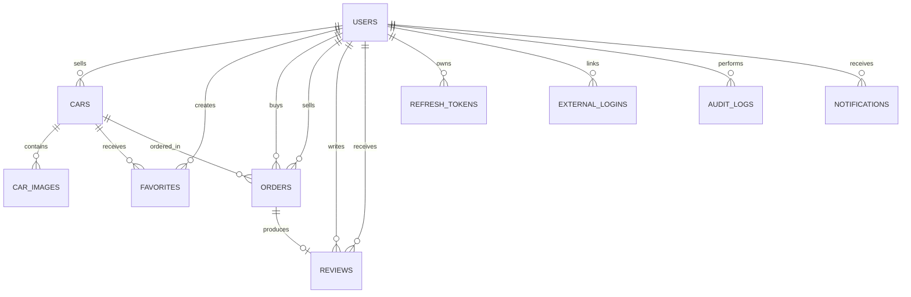

# Database schema

This document summarises the current SQL Server schema used by UUcars. The EF
Core model snapshot, migrations and entity configurations remain the source of
truth for exact implementation details.

## Overview

The database contains ten application tables:

| Table | Purpose | Introduced |
|---|---|---|
| `Users` | Accounts, roles and account-recovery state | V1; extended in V2 and V3 |
| `Cars` | Vehicle listings, moderation state and concurrency data | V1; extended in V3 |
| `CarImages` | Image URLs and display order for listings | V1 |
| `Favorites` | User-to-car favourite relationships | V1 |
| `Orders` | Buyer and seller transaction records | V1 |
| `Reviews` | Buyer reviews for completed orders | V2 |
| `RefreshTokens` | Refresh-token rotation and revocation records | V3 |
| `AuditLogs` | Administrative moderation history | V3 |
| `Notifications` | Persistent user notifications | V3 |
| `ExternalLogins` | Google identity links for local users | V3 |

## Tables

### Users

`Users` stores local and externally linked accounts.

| Column | SQL type | Null | Notes |
|---|---|---:|---|
| `Id` | `int` | No | Identity primary key |
| `Username` | `nvarchar(50)` | No | Display and account name |
| `Email` | `nvarchar(100)` | No | Unique |
| `PasswordHash` | `nvarchar(256)` | Yes | Null for external-only accounts |
| `Role` | `nvarchar(20)` | No | `User` or `Admin` |
| `EmailConfirmed` | `bit` | No | Defaults to `false` |
| `EmailConfirmationToken` | `nvarchar(200)` | Yes | One-time verification token |
| `EmailConfirmationTokenExpiry` | `datetime2` | Yes | Verification expiry |
| `ResetPasswordToken` | `nvarchar(200)` | Yes | One-time reset token |
| `ResetPasswordTokenExpiry` | `datetime2` | Yes | Reset expiry |
| `CreatedAt`, `UpdatedAt` | `datetime2` | No | UTC application timestamps |

Key index: unique `IX_Users_Email`.

### Cars

`Cars` stores vehicle listings and their workflow state.

| Column | SQL type | Null | Notes |
|---|---|---:|---|
| `Id` | `int` | No | Identity primary key |
| `Title` | `nvarchar(100)` | No | Listing title |
| `Brand`, `Model` | `nvarchar(50)` | No | Vehicle identification |
| `Year`, `Mileage` | `int` | No | Vehicle details |
| `Price` | `decimal(18,2)` | No | Listing price |
| `Description` | `nvarchar(2000)` | Yes | Optional description |
| `SellerId` | `int` | No | Foreign key to `Users` |
| `Status` | `nvarchar(20)` | No | `Draft`, `PendingReview`, `Published`, `Sold` or `Deleted` |
| `RowVersion` | `rowversion` | No | Optimistic concurrency token |
| `CreatedAt`, `UpdatedAt` | `datetime2` | No | UTC application timestamps |

Query indexes:

- `IX_Cars_Status_CreatedAt` on `(Status, CreatedAt DESC)`;
- `IX_Cars_Status_Brand` on `(Status, Brand)`;
- `IX_Cars_Status_Price` on `(Status, Price)`;
- `IX_Cars_SellerId_Status_CreatedAt` on
  `(SellerId, Status, CreatedAt DESC)`.

### CarImages

`CarImages` stores Cloudflare R2 public URLs rather than file content.

| Column | SQL type | Null | Notes |
|---|---|---:|---|
| `Id` | `int` | No | Identity primary key |
| `CarId` | `int` | No | Foreign key to `Cars` |
| `ImageUrl` | `nvarchar(500)` | No | Public image URL |
| `SortOrder` | `int` | No | Defaults to `0` |

### Favorites

`Favorites` is a join table with the composite primary key
`(UserId, CarId)`. It also stores `CreatedAt`. The composite key prevents the
same user from favouriting the same car more than once.

### Orders

`Orders` stores the car, buyer, seller, agreed `decimal(18,2)` price, status and
creation/update timestamps. Status is stored as `Pending`, `Completed` or
`Cancelled`. Separate indexes support car, buyer and seller lookups.

### Reviews

`Reviews` connects one completed order to its reviewer and reviewee. It stores
an integer rating, an optional `nvarchar(500)` comment and timestamps.
`IX_Reviews_OrderId` is unique, so an order can receive at most one review.
Rating range and ownership rules are enforced by the API service layer.

### RefreshTokens

`RefreshTokens` stores a unique opaque token, its user, expiry, revocation state
and creation time. The composite index
`IX_RefreshTokens_UserId_IsRevoked_ExpiresAt` supports validation and cleanup.

### ExternalLogins

`ExternalLogins` stores `Provider`, `ProviderSubject`, `UserId` and `CreatedAt`.
The unique `(Provider, ProviderSubject)` index ensures that one external
identity cannot be linked to multiple local users. Provider access and refresh
tokens are not stored.

### AuditLogs

`AuditLogs` is an append-only record of sensitive Admin actions. It stores the
Admin user, action, entity type, entity ID, optional detail and creation time.
`EntityType` and `EntityId` are generic references rather than foreign keys.
The `(Action, CreatedAt)` index supports operational review.

### Notifications

`Notifications` stores the recipient, notification type, message, optional
related entity ID, read state and creation time. SignalR provides immediate
delivery, while this table preserves notifications for offline users. The
`(UserId, IsRead, CreatedAt)` index supports unread-notification queries.

## Relationships and delete behaviour

| Principal | Dependent | Foreign key | Delete behaviour |
|---|---|---|---|
| `Users` | `Cars` | `SellerId` | Restrict |
| `Cars` | `CarImages` | `CarId` | Cascade |
| `Users` | `Favorites` | `UserId` | Cascade |
| `Cars` | `Favorites` | `CarId` | Cascade |
| `Cars` | `Orders` | `CarId` | Restrict |
| `Users` | `Orders` | `BuyerId` | Restrict |
| `Users` | `Orders` | `SellerId` | Restrict |
| `Orders` | `Reviews` | `OrderId` | Restrict |
| `Users` | `Reviews` | `ReviewerId` | Restrict |
| `Users` | `Reviews` | `RevieweeId` | Restrict |
| `Users` | `RefreshTokens` | `UserId` | Cascade |
| `Users` | `ExternalLogins` | `UserId` | Cascade |
| `Users` | `AuditLogs` | `AdminId` | Restrict |
| `Users` | `Notifications` | `UserId` | Cascade |

Restrict relationships preserve marketplace, transaction, review and audit
history. Cascade relationships remove records that have no meaning without
their parent.

## Concurrency

`Cars.RowVersion` is a SQL Server `rowversion` column configured as an EF Core
concurrency token. Updates compare the original value in the SQL `UPDATE`
condition. A competing update produces a concurrency exception rather than
silently overwriting newer data.

## Migration history

| Version | Migration | Change |
|---|---|---|
| V1 | `20260403095259_InitialCreate` | Created users, cars, images, favourites and orders |
| V2 | `20260423100822_AddEmailVerificationFields` | Added email-verification fields |
| V2 | `20260424011110_AddPasswordResetFields` | Added password-reset fields |
| V2 | `20260427020720_AddReviewsTable` | Added reviews |
| V3 | `20260526115201_AddCarIndexes` | Added listing query indexes |
| V3 | `20260612043831_AddRefreshTokensTable` | Added refresh-token persistence |
| V3 | `20260616120500_AddCarRowVersion` | Added optimistic concurrency |
| V3 | `20260619231332_AddAuditLogsTable` | Added Admin audit history |
| V3 | `20260721041503_AddNotificationsTable` | Added persistent notifications |
| V3 | `20260903014903_AddExternalLoginsForGoogleOidc` | Added external identities and nullable password hashes |

Exact column definitions and generated constraints are available in:

- `UUcars.API/Migrations/AppDbContextModelSnapshot.cs`;
- `UUcars.API/Migrations/`;
- `UUcars.API/Configurations/`.
